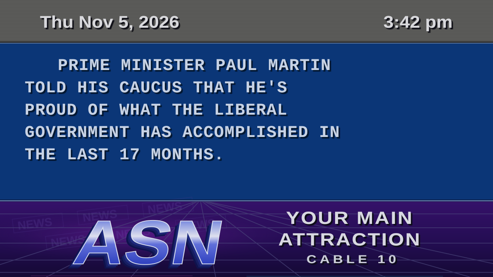
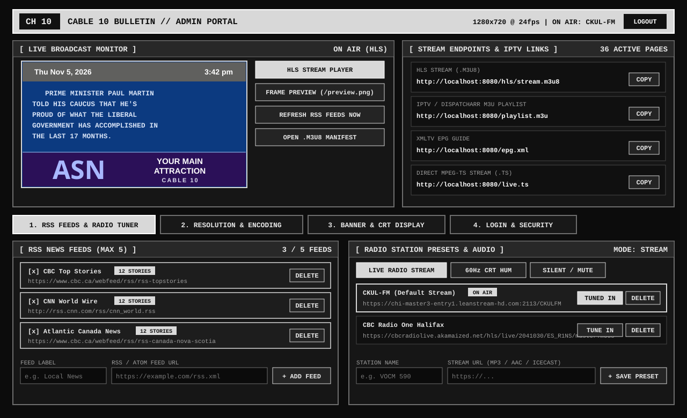
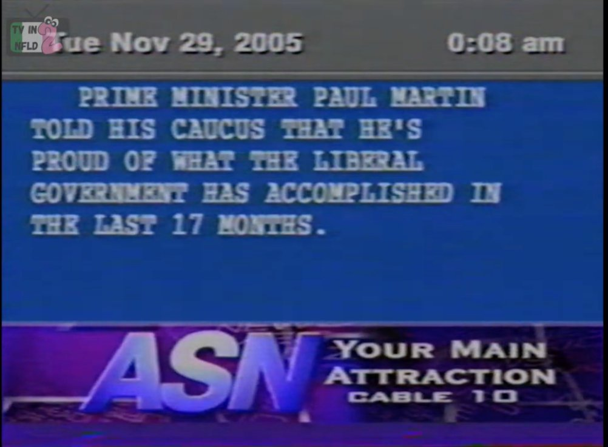

# Vintage Cable TV Bulletin Board (`cable-bulletin-hls`) 📺

A lightweight, self-contained Docker container that recreates the iconic **ASN / Cable 10 (Atlantic Satellite Network)** vintage Cable TV Character Generator & Community Bulletin Board in **full colour**, outputting a live **HLS stream** (`.m3u8` + `.ts` segments) with live background radio.

All **RSS news feeds (up to 5)**, **radio station presets**, and **on-screen banner graphics** are controlled directly through the built-in **Admin Portal** and persisted to `/app/data/settings.json`.

Unlike browser-capture streamers, `cable-bulletin-hls` does **not** use Chromium or Puppeteer. Frames are rendered directly in 24-bit RGB using Python's Pillow library and piped straight into FFmpeg (`rgb24` -> `yuv420p` H.264), keeping CPU and memory usage minimal for 24/7 operation on Unraid, Docker hosts, or home servers.

---

## Screenshots

### Live HLS Broadcast Output (`/hls/stream.m3u8` & `/preview.png`)


### Built-In Admin Portal (`http://<host>:8080/`)


### Original 2005 ASN / Cable 10 Reference Capture


---

## Screen Layout (ASN / Cable 10 Reference Style)

```text
+-------------------------------------------------------------------------+
|   Thu Nov 5, 2026                                             3:05 pm   |
+=========================================================================+
|                                                                         |
|      PRIME MINISTER PAUL MARTIN                                         |
|   TOLD HIS CAUCUS THAT HE'S                                             |
|   PROUD OF WHAT THE LIBERAL                                             |
|   GOVERNMENT HAS ACCOMPLISHED IN                                        |
|   THE LAST 17 MONTHS.                                                   |
|                                                                         |
+=========================================================================+
|              ////       ///        YOUR MAIN                            |
|            ASN                     ATTRACTION                           |
|          ////       ///             CABLE 10                            |
+-------------------------------------------------------------------------+
```

1. **Top Band (Date & Clock Bar)**:
   - Gunmetal-grey bar (`#60605e`) with a 3D beveled lower edge.
   - Left-aligned Date (`Tue Nov 29, 2005` format) and right-aligned 12-hour Time (`0:08 am` format) in bold sans-serif with heavy drop shadows.
2. **Middle Band (Bulletin Copy Field)**:
   - Deep broadcast royal-blue field (`#0c3a80`) with CRT scanlines.
   - Displays one concise 4-to-6 line **ALL-CAPS** news paragraph at a time in a wide **bold slab-serif typewriter font** (`CourierPrime-Bold` / `FreeMonoBold`) in pale ice-white (`#d6e2f6`) with the **first line indented by 3 spaces** and a deep navy drop shadow.
3. **Bottom Band (ASN / Cable 10 Graphic Promo Banner)**:
   - Rich violet-to-indigo background gradient (`#381070` -> `#180e40`) with a 3D perspective wireframe grid, faint angled `NEWS` watermark blocks, and subtle bottom-edge VHS chroma head-switching noise.
   - Giant 3D extruded blue-chrome metallic block logo on the left (`ASN` by default) and stacked wide-tracked promo text on the right (`YOUR MAIN` / `ATTRACTION` / `CABLE 10`)—all customizable in the Admin Portal.

---

## Admin Portal Features (`http://<host>:8080/`)

- **Custom RSS Feeds (Up to 5 Feeds)**:
  - Add, enable/disable, or delete up to **5 custom RSS or Atom feeds** directly from the web UI.
  - Enabled feeds are automatically fetched, sanitized into broadcast-wire paragraphs, and interleaved round-robin onto the bulletin board.
- **Radio Station Presets & Live Tuner**:
  - Save multiple internet radio streams (MP3, AAC, Icecast, Leanstream, Shoutcast) as named presets.
  - Click **TUNE IN** next to any preset to switch the live HLS stream's background audio on the fly without restarting the container.
  - Switch between **Live Radio Stream** (`stream`), **60 Hz CRT Hum** (`hum`), or **Silent / Mute** (`silent`) at any time.
- **Banner & CRT Customizer**:
  - Edit the 3D Left Banner Logo (`ASN`), Right Banner Lines 1–3 (`YOUR MAIN`, `ATTRACTION`, `CABLE 10`), page hold duration, typewriter reveal speed, and CRT scanline/noise/vignette effects live.
- **Persistent Storage**:
  - All Admin Portal settings are saved to `/app/data/settings.json` (mounted to `./data` in `docker-compose.yml`).

---

## Quick Start

### Option 1: Docker Compose (Recommended)

```yaml
services:
  cable-bulletin-hls:
    build: .
    image: cable-bulletin-hls:latest
    container_name: cable-bulletin-hls
    restart: unless-stopped
    ports:
      - "${PORT:-8080}:8080"
    volumes:
      - ./data:/app/data
    environment:
      - PORT=8080
      - DATA_DIR=/app/data
      - TZ=America/Halifax
      - CHANNEL_NUMBER=10
      - CHANNEL_NAME=CABLE 10 BULLETIN
      - BANNER_LOGO=ASN
      - BANNER_LINE_1=YOUR MAIN
      - BANNER_LINE_2=ATTRACTION
      - BANNER_LINE_3=CABLE 10
      - WIDTH=1280
      - HEIGHT=720
      - FPS=24
      - PAGE_DURATION=12
      - TYPEWRITER_DURATION=1.2
      - SCANLINES=true
      - CRT_NOISE=true
      - CRT_VIGNETTE=true
      - AUDIO_MODE=stream
      - AUDIO_STREAM_URL=https://chi-master3-entry1.leanstream-hd.com:2113/CKULFM
      - REFRESH_INTERVAL_MINUTES=10
```

Build and start:

```bash
docker compose up -d --build
```

Open **`http://localhost:8080`** to access the Admin Portal, manage your RSS feeds and radio presets, and watch the live HLS broadcast.

### Option 2: Docker CLI

```bash
docker build -t cable-bulletin-hls:latest .

docker run -d \
  --name cable-bulletin-hls \
  --restart unless-stopped \
  -p 8080:8080 \
  -v $(pwd)/data:/app/data \
  -e TZ=America/Halifax \
  cable-bulletin-hls:latest
```

---

## Dispatcharr / Jellyfin / Plex / VLC Setup

### Dispatcharr or Jellyfin Live TV
1. Add a new **M3U Tuner**:
   - **M3U URL**: `http://<server-ip>:8080/playlist.m3u`
   - *(Or point a custom stream directly to `http://<server-ip>:8080/hls/stream.m3u8` or `http://<server-ip>:8080/live.ts`)*
2. Add an **XMLTV Guide Provider**:
   - **XMLTV URL**: `http://<server-ip>:8080/epg.xml`

### VLC / MPV / Apple TV / IINA
Open Network Stream and enter:
```text
http://<server-ip>:8080/hls/stream.m3u8
```

---

## Stream & API Endpoints

| Path | Description |
| :--- | :--- |
| `/` | **Admin Portal** & live full-colour HLS broadcast monitor |
| `/hls/stream.m3u8` | **Primary HLS stream manifest** (`.m3u8`) |
| `/stream.m3u8` | Root alias for `/hls/stream.m3u8` |
| `/live.ts` *(or `/stream`)* | Continuous **MPEG-TS** HTTP stream (`video/mp2t`) |
| `/playlist.m3u` | **M3U Playlist** for Dispatcharr, Jellyfin, Plex, TiviMate, or VLC |
| `/epg.xml` | **XMLTV EPG** guide data |
| `/preview.png` | Instant full-colour PNG snapshot of the current bulletin frame |
| `GET /api/status` | Full JSON status (encoder state, feed counts, saved settings, active headlines) |
| `POST /api/feeds` | Add a new RSS feed (`{name, url, enabled}`) — max 5 feeds |
| `PUT /api/feeds` | Replace the RSS feeds list (`{rss_feeds: [...]}`) — max 5 feeds |
| `PATCH /api/feeds/{id}` | Enable or disable an RSS feed (`{enabled}`) |
| `DELETE /api/feeds/{id}` | Delete an RSS feed |
| `POST /api/radio/presets` | Add a radio station preset (`{name, url, activate}`) |
| `PUT /api/radio/presets/{id}` | Update a radio station preset (`{name, url}`) |
| `POST /api/radio/select` | Switch active radio preset or audio mode (`{audio_mode, active_radio_id}`) |
| `DELETE /api/radio/presets/{id}` | Delete a radio station preset |
| `PUT /api/display` | Update banner text and CRT display settings |
| `POST /api/refresh` | Trigger an immediate RSS refresh across all enabled feeds |
| `GET /health` | Container healthcheck endpoint |

---

## Environment Variables (Initial Defaults)

Environment variables seed the initial defaults when `/app/data/settings.json` is first created. Once saved via the Admin Portal, changes in `/app/data/settings.json` take precedence:

| Variable | Default | Description |
| :--- | :--- | :--- |
| `PORT` | `8080` | HTTP server & Admin Portal port |
| `DATA_DIR` | `/app/data` | Directory where `settings.json` is persisted |
| `TZ` | `UTC` | Local timezone for the top broadcast clock (e.g. `America/Halifax`) |
| `CHANNEL_NUMBER` | `10` | Channel number used in M3U/EPG metadata |
| `CHANNEL_NAME` | `CABLE 10 BULLETIN` | Channel name used in M3U/EPG metadata and portal header |
| `BANNER_LOGO` | `ASN` | Initial 3D metallic logo on the left of the bottom banner |
| `BANNER_LINE_1` | `YOUR MAIN` | Initial right-side banner line 1 |
| `BANNER_LINE_2` | `ATTRACTION` | Initial right-side banner line 2 |
| `BANNER_LINE_3` | `CABLE 10` | Initial right-side banner line 3 |
| `SHOW_SOURCE_PREFIX` | `false` | Prefix story text with `[FEED NAME]` |
| `WIDTH` | `1280` | Output video width |
| `HEIGHT` | `720` | Output video height |
| `FPS` | `24` | Video frame rate |
| `VIDEO_BITRATE` | `2200k` | Target H.264 bitrate |
| `PAGE_DURATION` | `12` | Default seconds per bulletin story |
| `TYPEWRITER_DURATION` | `1.2` | Default seconds for typewriter reveal (`0` for instant page flips) |
| `SCANLINES` | `true` | Enable horizontal CRT scanlines |
| `CRT_NOISE` | `true` | Enable subtle analog RF grain & bottom VHS chroma shimmer |
| `CRT_VIGNETTE` | `true` | Enable CRT corner vignette darkening |
| `AUDIO_MODE` | `stream` | Initial audio mode (`stream`, `hum`, or `silent`) |
| `AUDIO_STREAM_URL` | `https://...CKULFM` | Initial radio preset URL |
| `REFRESH_INTERVAL_MINUTES` | `10` | Background RSS refresh interval in minutes |

---

## Project Structure

```text
cable-bulletin-hls/
├── Dockerfile               # Python 3.11-slim + FFmpeg + CourierPrime/FreeMono/Liberation fonts
├── docker-compose.yml       # Docker Compose configuration with ./data volume
├── requirements.txt         # FastAPI, Uvicorn, Jinja2, Pillow
├── README.md                # Documentation
├── screenshots/             # Broadcast output, Admin Portal, and 2005 ASN reference images
└── app/
    ├── config.py            # Environment variable defaults
    ├── settings_store.py    # Persistent JSON store (/app/data/settings.json) for feeds, radio presets & banner
    ├── rss_fetcher.py       # Multi-feed RSS/Atom parser (up to 5 feeds) & broadcast wire formatter
    ├── renderer.py          # 24-bit RGB ASN / Cable 10 3-band CRT frame renderer (Pillow)
    ├── streamer.py          # FFmpeg HLS (.m3u8 + .ts) & MPEG-TS encoder with live radio switching
    ├── main.py              # FastAPI server, Admin Portal REST API, and HLS/M3U/EPG routes
    └── templates/
        └── index.html       # Admin Portal Web UI with live HLS monitor, feed manager & radio tuner
```
